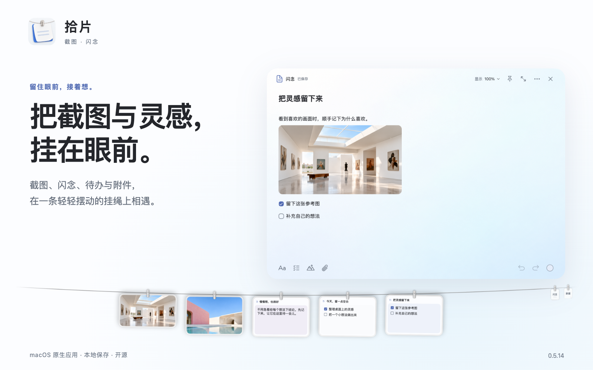
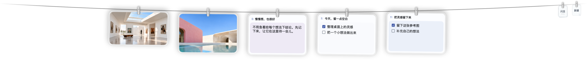
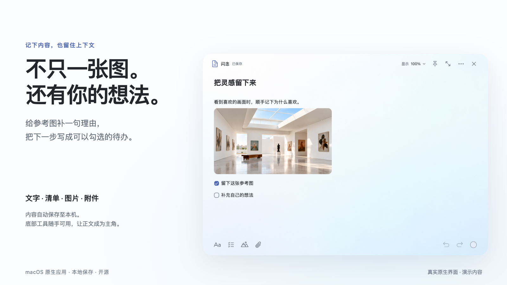
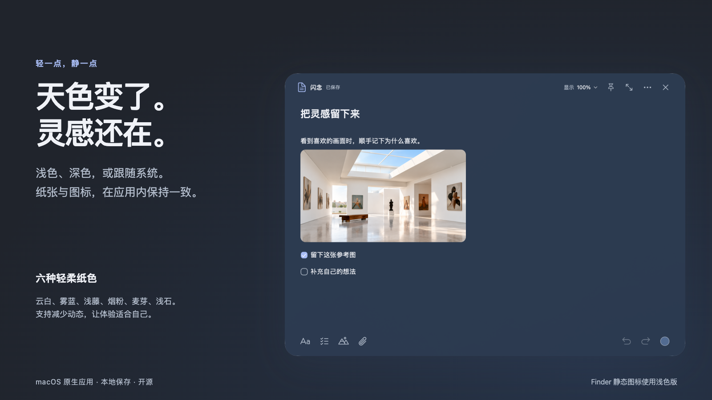

<picture>
  
</picture>

<p align="center">
  <strong>拾片</strong> · 把截图与灵感，挂在眼前。<br>
  macOS 原生 · 本地保存 · 开源<br><br>
  <a href="../../releases">下载 macOS 版</a> · <a href="#三步开始">三步开始</a> · <a href="#从源码构建">源码构建</a> · <a href="docs/launch/PRODUCT.md">完整产品介绍</a>
</p>

截图留下画面，闪念接住想法。拾片把两者挂在屏幕顶部的一条绳上：要用时展开，写完再收回。给喜欢的图补一句“为什么”，把临时想法写下来，或者留一张今天的待办，不必反复切换窗口。

> 当前为 **0.5.31**。提供 Apple Silicon（arm64）安装包，最低 macOS 14。采用本地 ad hoc 签名，**尚未经过 Apple 公证**，从互联网下载后，其他 Mac 可能需要在系统设置中手动确认打开。[查看本次更新](docs/launch/RELEASE-0.5.31.md)

## 先看它怎么用


首页直接循环展示，无需下载。GIF 无声音；[下载完整介绍视频（MP4，含配乐）](../../releases/download/v0.5.14/shipian-intro.mp4) · [查看分镜与字幕](docs/launch/VIDEO.md)

视频基于真实应用界面制作，使用虚构演示内容；画面运镜用于讲解产品，不作为实际动画流畅度测试。

配图和视频沿用早期版本的演示素材，新增的编辑、图片预览与恢复行为见本次更新说明。

## 截图与闪念，放在一起



- **截图挂绳**：沿用 Tendedero 的夹子、玻璃边框与摆动机制，截图和闪念处于同一个挂绳体系。
- **自动折叠**：图片与闪念默认各自在超过 4 项时折叠。点开分组沿同一根绳查看全部内容，可在「偏好设置 → 挂绳」分别开关并调整数量。
- **横向查看**：超出屏幕宽度的图片仍留在绳上，展开后可横向滑动查看。单张取下会保留文件，可从右键菜单单独选择「移到废纸篓」。
- **批量取下截图**：点击绳尾带 × 的小图片，短银杆会从左向右取下截图；保留闪念、录像和原文件，撤销提示在三秒后自动消失。
- **按需展开**：打开一条闪念继续编辑，收起后回到挂绳；闪念内容保留。
- **轻量入口**：绳尾保留闪念库和新建入口，优先把空间留给内容。

开启「复制图片时挂到绳上」后，支持复制单张图片、Finder 多选图片，以及附带来源网址的图片。图片按顺序保存为本机 PNG 副本，再挂上绳；原文件保留。仍在绳上的图片会去重，取下或清空后可重新挂上，本应用主动复制的图片会跳过自动收集。新挂图片提供三秒撤销，编辑闪念时静默挂图。极快连续复制、在检测前已被覆盖的内容仍可能漏掉。

「隔空投送图片自动挂上」默认开启。允许访问「下载」后，拾片会把新保存到该目录、且 macOS 标记为隔空投送的图片挂上绳。可以在「偏好设置 → 截图」单独关闭。

## 给一张图，添一点自己的想法



文字、待办、图片与文件附件共用连续编辑区，可跨段选择、调整选中文字的格式、撤销和重做。Aa 收纳完整格式选项；右上角的显示比例只改变阅读大小，保留原文字号。内容自动保存到本机，保存出错时会显示错误状态。底部保持单排工具，颜色入口直接可见。

选中文字后，就近出现段落、加粗、斜体、下划线与链接工具条。链接地址在编辑区内输入，保留选区和编辑焦点。悬停图片可调整宽度、替换图片和编辑说明，操作支持撤销。工具条沿用应用配色、线性图标和轻量动效，可点击按钮显示小手光标。

新建直接进入通用闪念，同一条可混排文字、图片和待办。支持 `⌘C` / `⌘V` 与 `Ctrl+C` / `Ctrl+V` 复制粘贴图片，也可把挂绳截图拖进正文；拖到正文按松手位置插入，拖到正文外的纸面空白处追加到末尾，原截图仍留在挂绳上。

输入数字、英文句点和空格可创建有序列表，输入减号或星号后按空格可创建无序列表；`Tab` / `Shift+Tab` 调整两级缩进，插入或删除条目后编号自动更新。默认粘贴匹配光标处的字体和字号，并移除来源背景等样式；可在 Aa 中选择保留来源格式。

图片预览支持适应窗口、原始像素、缩放、平移、复制和导出，并跟随应用深浅外观。多图编辑的图片缓存和布局已优化，减少图片反复加载引起的高度跳变。

编辑器右上角的 × 用于关闭窗口，关闭后内容保留，仍可从闪念库或挂绳打开。

粘贴单个完整 HTTP(S) 网址，会访问网页读取标题并显示为正文中的文字链接。单击链接即可打开原网址，`⌘` 点击同样可用；按住 `Option` 点击可定位编辑，拖动仍可选择文字。标题读取失败时保留网址。保存重开、跨闪念复制及 Markdown 导出保留链接目标。混合正文和多个网址不自动替换标题。

挂绳上的闪念预览会按可用高度尽量显示完整行，超出时在末行显示省略号。正文与待办按原顺序显示，长待办可继续换行，多条待办也不再固定只显示两条；短内容自然留白。

闪念库卡片根据剩余正文区高度展示更多文字和待办，超出后在末行省略。闪念库默认使用紧凑窗口，可拖动顶部空白或手动调整大小。挂绳会避让当前正在操作的拾片窗口及其确认框。

附件导入时会复制到应用的数据目录；Markdown 导出可携带附件，便于继续使用。

## 挂在眼前，也收进记忆里


闪念库提供「全部闪念」「挂绳上」「已取下」「最近删除」，支持标题和正文搜索、排序、制作副本与导出。从绳上取下会保留闪念；移入最近删除后可恢复，也可确认后清空最近删除。

## 从白天，到夜里



支持浅色、深色和跟随系统，提供云白、雾蓝、浅藤、烟粉、麦芽、浅石六种纸色。按钮有悬停提示；下拉菜单选项直接展示名称，不叠加重复提示。支持应用及系统的减少动态偏好。

已内置浅色与深色图标，应用运行时图标和设置中的图标随外观更新。Finder 中的静态图标使用浅色版。

## 三步开始

1. 下载 [拾片 0.5.31 安装包（DMG）](../../releases/download/v0.5.31/Shipian-0.5.31-arm64.dmg)，打开后将「拾片.app」拖到应用程序，或使用 [ZIP](../../releases/download/v0.5.31/Shipian-0.5.31-arm64.zip) 中的应用。
2. 启动后打开闪念库，新建一条闪念，按需加入文字、待办和图片。写好后再挂上；新建自动挂上默认关闭。
3. 在顶部挂绳中展开闪念继续编辑；暂时不用的内容取下后，仍可在闪念库找到。

拾片运行时显示在 Dock 和菜单栏，关闭窗口后仍可从这两个入口打开。需要完全退出时使用 Dock 或菜单栏的「退出拾片」。截图监听、截图接管与剪贴板图片挂绳按需在菜单栏启用，使用前请读清对应设置说明。本项目不使用原版 Tendedero 的应用身份或数据目录。

### 常用快捷键

| 操作 | 快捷键 |
| --- | --- |
| 新建闪念 | `⌘N` |
| 搜索 | `⌘F` |
| 撤销 / 重做 | `⌘Z` / `⇧⌘Z` |
| 加粗 / 斜体 / 下划线 | `⌘B` / `⌘I` / `⌘U` |
| 收起当前闪念 | `Esc` |
| 打开正文链接 | 单击，兼容 `⌘` 点击；`Option` 点击定位编辑 |
| 复制 / 粘贴图片 | `⌘C` / `⌘V`，兼容 `Ctrl+C` / `Ctrl+V` |
| 列表缩进 / 退一级 | `Tab` / `Shift+Tab` |

全局挂绳快捷键在菜单栏设置，可能因个人设置而不同。

## 数据与当前边界

闪念及附件副本保存在 `~/Library/Application Support/LineNotes Test`。沿用这个数据目录名称，是为了继续读取已有数据。请勿同时运行旧版 LineNotes Test 和拾片。

内容自动保存在本机，关闭和更新后沿用同一份资料；异常退出后的临时内容会在恢复或保存成功后清理。应用不生成完整历史归档，不提供手动备份与恢复管理入口。最近删除可一键清空，确认前会显示总数量，永久删除不影响外部原始附件。当前应用没有账号、云同步和协作服务。仓库中的演示图片与笔记不包含用户个人截图。当前提供的二进制仅在 Apple Silicon 上验收；Intel 编译和跨设备测试尚未完成，也没有 App Store 版本。

挂绳图片暂时读取失败或仍在加载时，会保留其路径和原有顺序，下次启动重试。挂绳上的原图仍依赖原文件；文件被删除或所在磁盘不可用时，需要先恢复文件可读性。导入闪念的附件使用独立副本。

挂绳收起时暂停周期性微风动画，展开后的摆动更快稳定；空挂绳及拖动期间不触发微风。CPU 占用随图片数量、剪贴板监听和使用状态变化，不承诺固定降幅。

## 从源码构建

应用运行需要 macOS 14 或更新系统。正式品牌包构建需要包含 Icon Composer / actool 的 Xcode 26 或更新版本、Python 3 和 `ripgrep`（UI 验收脚本使用）；普通开发版与测试需要 Swift 6.0 或更新工具链，首次构建通过 Swift Package Manager 获取固定版本的 SwiftSoup 依赖。

```sh
git clone https://github.com/LeeYH95/withinsight.git
cd withinsight
scripts/build-release.sh
open 'build/shipian-release/拾片.app'
```

构建脚本使用本机架构，不会自动生成通用二进制。应用输出到 `build/`，使用 ad hoc 签名。

```sh
# 单元与集成测试
CLANG_MODULE_CACHE_PATH="$PWD/.build/ModuleCache" \
SWIFTPM_MODULECACHE_OVERRIDE="$PWD/.build/ModuleCache" swift test --disable-sandbox

# 原生 UI 行为验收；需要可用的 macOS 桌面会话
Tests/NativeNotesUIHarness/run.sh

# 独立演示数据，不扫描个人截图、不注册全局快捷键
'build/shipian-release/拾片.app/Contents/MacOS/LineNotes' \
  --demo --data-dir "$PWD/runtime/demo"

# Debug 构建可额外传 --demo-rope，只展示挂绳并保持展开，便于检查动效
# 独立 bundle ID 使用各自的演示挂绳偏好，互不覆盖
```

## 反馈与参与

使用 [Bug 报告](../../issues/new?template=bug_report.yml) 提交系统版本、应用版本、复现步骤与预期行为；截图前请遮挡个人信息。提出功能想法请说明实际场景。欢迎提交聚焦的 Pull Request；涉及数据保存、附件和删除行为的改动需要测试。

## 相关发布工具

[github-product-launch](https://github.com/LeeYH95/github-product-launch) 已作为独立 Skill 维护，可用于给软件项目制作 README、Banner、功能说明、介绍视频和发布检查报告。安装与使用方法见独立仓库。

## 来源与许可

拾片基于 [Tendedero](https://github.com/alejandrobujan/tendedero) v1.5.0 二次开发，保留其截图挂绳与物理交互机制。感谢 Alejandro Buján 的原始实现。

代码遵循 [MIT License](LICENSE)，上游名称和图标不在该授权内。编辑工具图标使用 Phosphor Icons，保留其 [MIT 声明](PHOSPHOR-LICENSE.txt)。本项目使用独立名称、图标与宣传素材，不代表得到上游背书。详见 [NOTICE.md](NOTICE.md)。
